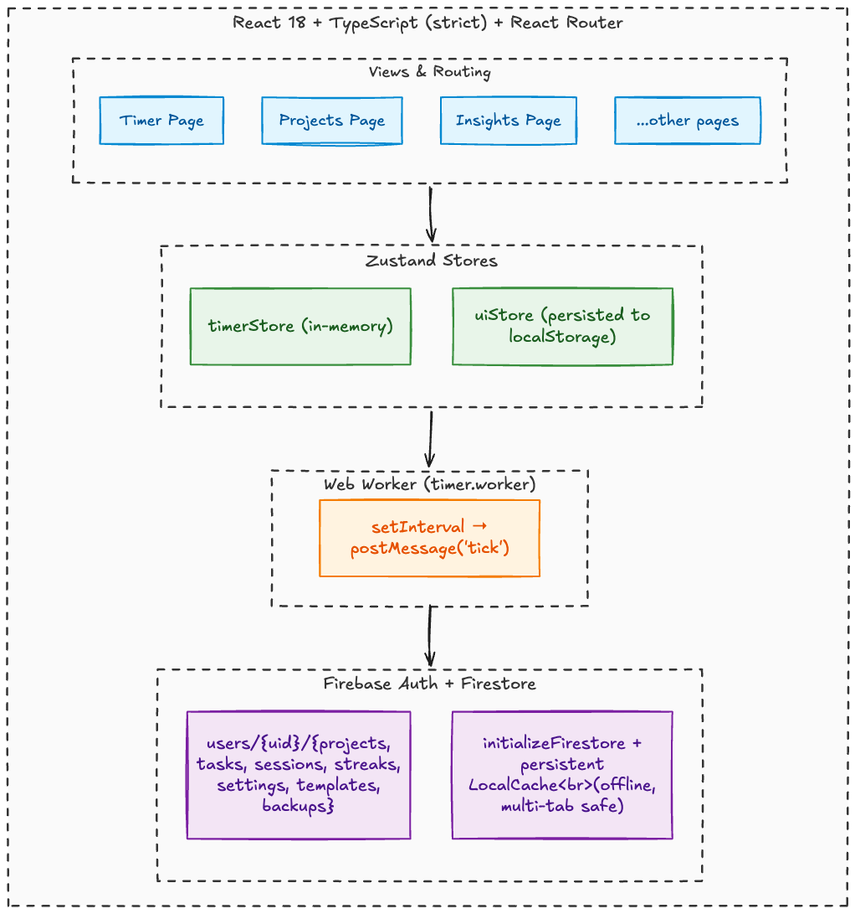

<div align="center">

# ClockWise

**A minimalist Pomodoro timer that tracks where your focus time actually goes, synced across devices.**

[](https://github.com/kaushik-3009/ClockWise/actions/workflows/ci.yml)
[](https://www.typescriptlang.org/)
[](https://opensource.org/licenses/MIT)
[](https://web.dev/progressive-web-apps/)

[Live Demo](https://clock-wise-nine.vercel.app/) · [Report a Bug](https://github.com/kaushik-3009/ClockWise/issues) · [Request a Feature](https://github.com/kaushik-3009/ClockWise/issues)

</div>

---

## Why

Every Pomodoro app I tried either spammed ads or locked basic features like session analytics and themes behind an $8/month paywall. I got tired of it and built my own clean, customizable pomodoro application with actual analytics.

It started as a local-only app for personal use. Then I figured if I was building it anyway, I might as well add accounts and sync so anyone could use it. No ads, freemium tiers, or strings attached. Pick a project, start the timer, and everything gets logged automatically. Over weeks that becomes heatmaps, streaks, and trend charts that answer "where did my time go this week?"

---

## Tech Stack

| Layer | Technology |
|---|---|
| Frontend | React 18, TypeScript (strict), React Router |
| State | Zustand (with per-field selectors) |
| Timer | Wall-clock engine in a Zustand store, persisted to `localStorage` |
| Backend / Auth | Firebase Auth + Firestore |
| Build | Vite |
| Testing | Vitest |
| CI | GitHub Actions |

---

## Features

- **Timer** -- configurable focus/break phases, three faces (digital, dial, clock), keyboard shortcuts (`Space`, `R`, `S`, `Esc`, can be turned off). Keeps correct time when the phone locks, the app is backgrounded or killed, and across open tabs
- **Projects & tasks** -- color-coded projects with tasks you can tick off, creatable inline from the *"I'm focusing on..."* picker; archive and restore projects
- **History** -- every phase logged automatically, editable, plus manual time entry ("Log time")
- **Analytics** -- statistics with like-for-like comparisons ("this week so far vs the same point last week"), insights on weekday and time-of-day patterns, a heatmap, streaks and a weekly goal
- **Templates** -- saved timer setups (Classic Pomodoro, Deep Work, Quick Sprint, Study Session, or your own)
- **Sound** -- lofi radio stations plus synthesized rain, café, white and brown noise (Web Audio, no files), and synthesized UI chimes
- **Installable PWA** -- iPhone safe areas, splash screens, update prompt, Wake Lock to keep the screen on while focusing, notifications via the service worker
- **Sync & offline** -- Firebase email/password auth, per-user Firestore data with offline persistence
- **Export / import** -- JSON backup (round-trips) and CSV with project and task names

---

## Architecture



---

## Getting Started

### Prerequisites

- Node.js >= 18
- A Firebase project with **Authentication** (email/password) and **Firestore** enabled

### Setup

```bash
git clone https://github.com/kaushik-3009/ClockWise.git
cd ClockWise
npm install

cp .env.example .env.local   # add your Firebase project config
npm run dev                  # start the dev server at localhost:5173
```

#### Without a Firebase project (local emulators)

Requires Java 11+. Any values in `.env.local` work, e.g. `VITE_FIREBASE_PROJECT_ID=demo-clockwise`.

```bash
npm run emulators   # Auth + Firestore emulators, enforcing firestore.rules
npm run dev:local   # dev server connected to the emulators
```

#### Deploying

Hosting is configured for Vercel (`vercel.json`: SPA rewrites, cache headers, CSP). Deploy Firestore rules with `npx firebase deploy --only firestore`.

### Commands

| Command | Description |
|---|---|
| `npm run dev` | Vite dev server |
| `npm run emulators` / `npm run dev:local` | Local Firebase emulators + dev server wired to them |
| `npm run build` | Type-check + production build |
| `npm test` | Run tests (Vitest) |
| `npm run test:watch` | Watch mode |
| `npm run lint` | ESLint on `src/` |
| `npx tsc --noEmit` | Type-check only |

---

### Notable Design Decisions

- **Wall-clock timer, not tick counting** -- the store keeps `running_since` + accumulated time and derives the remaining time from `Date.now()`. iOS freezes JavaScript in a backgrounded or locked PWA; on resume one `tick()` completes (and with auto-start chains) every phase that ended in the meantime, at the exact time it ended.
- **Pure store, effects outside** -- timer actions take `now` and return their effects (phases to record, sounds); `lib/timerController.ts` applies them. That makes the store testable with fake timestamps.
- **One engine for the whole app** -- `TimerEngine` lives in the app shell, so navigating away from the timer never stops it. A worker heartbeat keeps desktop background tabs on time; `visibilitychange`/`pageshow` re-sync on mobile.
- **Write sessions once, never wait on the network** -- a phase is written when it ends, fire-and-forget with a deterministic id (so several tabs finishing the same phase write one document). Firestore write promises only resolve on server ack, so nothing in the UI awaits them; failures surface as toasts.
- **One data provider** -- a single set of Firestore listeners shared by every page; sessions are loaded for a ~13-month window (History can load older). Every document is parsed at runtime (`db/parse.ts`) instead of cast.
- **Validated security rules** -- rules check ownership *and* field types, sizes and enums, mirroring the client-side parser.
- **Deleting keeps history** -- deleting a project or task never deletes its logged sessions.
- **Consistent definitions** -- focus time counts every focus session (finished or not); "sessions" are focus sessions; a day is active with at least a minute of focus. Used everywhere via `lib/stats.ts`.
- **Updates on your terms** -- the service worker uses the prompt strategy, so a deploy never swaps code under a running session; stale lazy chunks trigger a single reload.

---

## Project Structure

```
src/
  components/
    ui/           Modal (portal, bottom sheet on phones), Toast, ConfirmDialog, Switch, ErrorBoundary
    layout/       AppShell, Sidebar, BottomNav (with live mini timer), OfflineBanner
    auth/         ProtectedRoute, AuthLayout
    brand/        Logo
    timer/        TimerEngine, TimerDisplay, TimerControls, PhaseBadge, TaskPicker, TemplateSelector, MusicPlayer
    projects/     ProjectCard, TaskRow, ProjectForm, TaskForm
    stats/        HeatmapCalendar, charts, PeriodHeader, StatCard
  hooks/          useData + useProjects/useTasks/useSessions/useSettings/useTemplates, useTimerShortcuts, usePageTitle
  stores/         timerStore, uiStore, lofiStore (Zustand)
  db/             parse.ts (runtime validation), clean.ts, seed.ts, queries/
  workers/        timer.worker.ts (heartbeat)
  lib/            firebase, auth, data provider, timerController, stats, streaks, period, ambient, sounds, exportImport
  pages/          Landing, Login, Signup, Timer, Projects, ProjectDetail, History, Statistics, Insights, Streaks, Templates, Settings
```

---

## Testing

Unit tests cover the timer store (wall-clock catch-up after suspension, session lifecycle, mid-session settings changes), stats and streak maths (including DST and in-progress periods), phases, and export/import validation.

```bash
npm test             # run once
npm run test:watch   # watch mode
```

---

## Data & Sync

Everything lives under `users/{uid}/` in Firestore -- private by default, available on any signed-in device. Firestore's persistent local cache keeps the app working offline; writes queue and sync when you reconnect (an offline banner makes the state visible). Signing out clears the timer and the on-device cache. JSON/CSV export and JSON import are in Settings.

---

## CI

GitHub Actions runs **TypeScript type-check -> ESLint -> Vitest -> Vite build** on every push and pull request. All four gates must pass -- see [`.github/workflows/ci.yml`](https://github.com/kaushik-3009/ClockWise/blob/main/.github/workflows/ci.yml).

---

## License

[MIT](./LICENSE)
